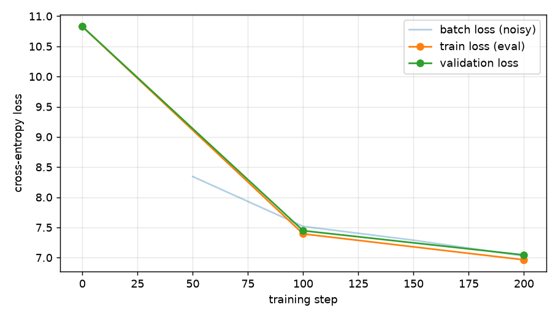

# Training Report

## Configuration

| setting | value |
|---|---|
| context length | 64 |
| embedding dimension | 64 |
| attention heads | 4 |
| transformer blocks | 1 |
| dropout | 0.0 |
| tied embedding/output weights | True |
| vocabulary size | 50257 |
| trainable parameters | 3,270,656 |
| training steps | 200 |
| batch size | 32 |
| optimizer | Adam, peak lr 0.003, 100 warm-up steps then cosine decay, grad-clip 1.0 |
| seed | 1337 |
| device | cpu |
| training tokens / validation tokens | 2,391,884 / 247,289 |
| wall-clock training time | 340.0 s |

## Loss results

Losses are cross-entropy in nats, averaged over 20 fixed batches per split (same batches at every evaluation). Step 0 is the untrained model; a model guessing uniformly would score ln(50257) = 10.825.

| step | train loss | validation loss |
|---|---|---|
| 0 | 10.8280 | 10.8275 |
| 100 | 7.3933 | 7.4462 |
| 200 | 6.9635 | 7.0441 |

* Best validation loss: **7.0441** at step 200 (this is the saved checkpoint).
* Final train / validation loss: 6.9635 / 7.0441 (gap +0.0806).
* Validation loss improved from 10.828 (before training) to 7.044 at step 200 and was still best at the end, so training had not yet converged.



## Generated samples (greedy decoding, 40 new tokens, from the saved checkpoint)

### Before training (random weights)

**Prompt:** `The history of`

```text
The history of Impro Impro Impro Impro Impro Impro Impro Impro Impro Impro Impro Impro Impro Impro Impro Impro Impro Impro Impro Impro Impro Impro Impro Impro Impro Impro Impro Impro Impro Impro Impro Impro Impro Impro Impro Impro Impro Impro Impro Impro
```

**Prompt:** `In 1990 , the`

```text
In 1990 , theBattleBattleBattleBattleBattleBattleBattleBattleBattleBattleBattleBattleBattleBattleBattleBattleBattleBattleBattleBattleBattleBattleBattleBattleBattleBattleBattleBattleBattleBattleBattleBattleBattleBattleBattleBattleBattle Double Double Double
```

**Prompt:** `The city is located`

```text
The city is located Grass Grass neighbourhood neighbourhood neighbourhood neighbourhood neighbourhood neighbourhood neighbourhood neighbourhood neighbourhood neighbourhood neighbourhood neighbourhood neighbourhood neighbourhood neighbourhood neighbourhood neighbourhood neighbourhood neighbourhood neighbourhood neighbourhood neighbourhood neighbourhood neighbourhood neighbourhood neighbourhood neighbourhood neighbourhood neighbourhood neighbourhood neighbourhood neighbourhood neighbourhood neighbourhood neighbourhood neighbourhood neighbourhood neighbourhood
```

### After training

**Prompt:** `The history of`

```text
The history of the the the the the the the the the the the the the the 


```

**Prompt:** `In 1990 , the`

```text
In 1990 , the the the the the 


 = = = = = = = = = = = = =
```

**Prompt:** `The city is located`

```text
The city is located , the the the the the the the the the the the the the the the the the 


```
